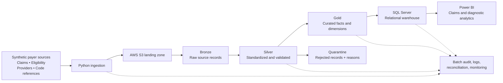

# 01 --- Project Overview

## 1. Project summary

The **Healthcare Claims Data Engineering & Analytics Platform** is an
end-to-end portfolio project that demonstrates the engineering lifecycle
for synthetic healthcare payer data. It covers source ingestion,
raw-data preservation, validation, transformation, quarantine,
relational warehousing, reconciliation, operational monitoring, and
analytical consumption.

The project is designed around the responsibilities of a Data Engineer
II working with analytics teams: producing reliable data products,
maintaining repeatable pipelines, protecting data integrity, documenting
processes, and making curated data accessible for analysis.

All records are synthetic. The project does not use protected health
information (PHI) or actual patient records.

## 2. Business problem

Healthcare payer analytics depends on data arriving from multiple
operational sources. Claims, eligibility, provider, diagnosis, and
procedure data may have different formats, identifiers, update
schedules, and quality issues.

Before analysts can use these datasets consistently, a data platform
must answer several questions:

-   Did every expected source file arrive?
-   Can the incoming records be parsed and traced to a batch?
-   Are required identifiers and dates present and valid?
-   Do member and provider references resolve?
-   Are duplicate claim lines detected?
-   Which records failed validation, and why?
-   Do source and warehouse counts and financial totals reconcile?
-   Can analysts query a consistent, documented data model?

This project implements a synthetic example of that workflow.

## 3. Project goals

1.  Create realistic but non-identifying synthetic healthcare payer
    datasets.
2.  Build repeatable batch ingestion using Python.
3.  Preserve source records and ingestion metadata in a Bronze layer.
4.  Standardize and validate data in a Silver layer.
5.  Quarantine invalid records with explicit rejection reasons.
6.  Publish curated Gold data for analytical use.
7.  Design a SQL Server relational warehouse with appropriate keys,
    constraints, and indexes.
8.  Record batch execution, row counts, rejected records, and
    reconciliation results.
9.  Provide analytical datasets for claims and diagnostic-utilization
    reporting.
10. Add tests and operational documentation so another developer can
    reproduce the workflow.

## 4. Scope

### Included

-   Synthetic medical claim headers and claim lines.
-   Synthetic member eligibility periods.
-   Synthetic provider directory records.
-   Diagnosis and procedure reference datasets.
-   Batch-based file ingestion.
-   Raw, standardized, and curated data layers.
-   Configurable data-quality checks.
-   Rejected-record quarantine and rejection explanations.
-   SQL Server warehouse schema and analytical views.
-   Batch audit and source-to-target reconciliation.
-   Python/PySpark processing patterns.
-   Automated tests and structured logs.
-   Power BI-oriented analytical outputs and dashboard specifications.

### Not included unless explicitly added later

-   Processing real patient data or PHI.
-   Live payer production integrations.
-   A production claims adjudication engine.
-   Clinical recommendations or medical decision-making.
-   Full certification or conformance testing for X12, HL7, or FHIR.
-   A production-grade implementation of every cloud service shown in
    the target architecture.
-   A claim that the project has been deployed in a healthcare
    organization.

## 5. Source datasets

The initial synthetic source system will contain the following logical
datasets:

  -----------------------------------------------------------------------
  Dataset                 Example grain           Example attributes
  ----------------------- ----------------------- -----------------------
  Medical claims          One claim line per      Claim ID, line number,
                          record, linked to a     member ID, provider ID,
                          claim header            service date, procedure
                                                  code, diagnosis code,
                                                  billed amount, allowed
                                                  amount, paid amount

  Member eligibility      One member coverage     Member ID, effective
                          period per record       date, termination date,
                                                  plan ID, coverage
                                                  status

  Provider directory      One provider identity   Provider ID, NPI-like
                          or effective-dated      synthetic identifier,
                          provider record         provider type,
                                                  specialty, location

  Diagnosis reference     One diagnosis code per  Diagnosis code,
                          record                  description,
                                                  code-system label,
                                                  effective dates

  Procedure reference     One procedure code per  Procedure code,
                          record                  description,
                                                  code-system label,
                                                  effective dates
  -----------------------------------------------------------------------

The synthetic data generator will use clearly artificial identifiers and
controlled distributions. Code values may be illustrative; they will not
be represented as a complete or authoritative licensed code set.

## 6. Target architecture and data flow

The architecture diagram image for the GitHub README can be stored at
`docs/architecture.png`. The diagram represents the intended design.
Each component will be labeled in project documentation as implemented,
in progress, or planned based on actual working evidence.

### Bronze layer

-   Preserve incoming source content as received, subject to safe file
    handling.
-   Add ingestion metadata such as source name, batch ID, file name, and
    ingestion timestamp.
-   Avoid applying business transformations that obscure the original
    source values.

### Silver layer

-   Parse and standardize dates, identifiers, codes, and numeric values.
-   Detect duplicate records according to a documented business key.
-   Validate required fields and reference relationships.
-   Separate accepted records from rejected records.
-   Store rejection reasons to support investigation and remediation.

### Gold layer

-   Publish curated facts, dimensions, and aggregate datasets.
-   Apply documented business definitions.
-   Support repeatable analytical queries and reporting.
-   Keep business rules explicit and testable.

## 7. Data-quality framework

Validation rules will be grouped into categories:

  -----------------------------------------------------------------------
  Category                Example check           Expected handling
  ----------------------- ----------------------- -----------------------
  Completeness            Required claim ID or    Reject or quarantine
                          service date is missing 

  Type and format         Date cannot be parsed   Reject or quarantine
                          or amount is not        
                          numeric                 

  Uniqueness              Duplicate claim-line    Flag and apply
                          business key            documented duplicate
                                                  policy

  Referential integrity   Member or provider key  Quarantine or hold for
                          does not resolve        reference-data review

  Domain validity         Unsupported status or   Reject or flag
                          malformed code          according to rule
                                                  severity

  Financial plausibility  Amount relationships    Flag or quarantine
                          violate a configured    based on payer-specific
                          rule                    policy

  Reconciliation          Source and target       Record variance and
                          counts or totals differ investigate
  -----------------------------------------------------------------------

Financial relationships such as `paid_amount <= allowed_amount` are not
universal truths for every payer, adjustment, or claim scenario. They
will be treated as configurable checks, not unconditional industry
rules. Reversals, adjustments, coordination of benefits, and
payer-specific conventions require explicit handling.

## 8. Warehouse design principles

The warehouse will use a documented relational model. A likely starting
design includes:

-   Claim header or claim transaction entity.
-   Claim-line fact table at a clearly stated line-level grain.
-   Member dimension, potentially effective-dated.
-   Provider dimension, potentially effective-dated.
-   Date dimension.
-   Diagnosis and procedure reference dimensions.
-   Batch audit table and data-quality result tables.

Primary keys, foreign keys, uniqueness constraints, and indexes will be
selected based on the access patterns and data semantics. Slowly
changing dimension behavior will be documented where effective-dated
attributes are needed.

## 9. Batch audit and operational monitoring

Each pipeline run should capture, at minimum:

-   Batch ID and source identifier.
-   Start and end timestamps in UTC.
-   Run status and failure details.
-   Input, accepted, rejected, and loaded row counts.
-   Duplicate counts where applicable.
-   Source and target reconciliation measures.
-   Code or pipeline version where practical.

The pipeline should fail visibly when critical conditions occur.
Recoverable record-level validation failures should be isolated from
infrastructure or pipeline failures. Retry behavior must avoid duplicate
loads.

## 10. Analytics use cases

The curated data will support example reports such as:

### Claims analytics

-   Claim-line volume and paid amount by month.
-   Billed, allowed, and paid amount trends.
-   Claim volume by plan, provider type, and geography.
-   Procedure and diagnosis category distributions.
-   Adjustment and reversal trends if those records are modeled.

### Diagnostic utilization

-   Procedure utilization over time.
-   Tests per 1,000 eligible members, using a clearly defined
    member-month denominator.
-   Utilization by provider specialty and geography.
-   Changes in utilization across plans and periods.

### Data-quality and operations

-   Pipeline run success and duration.
-   Accepted versus rejected record rates.
-   Rejection reasons by source and batch.
-   Duplicate and referential-integrity exception counts.
-   Reconciliation variances.

These are analytical examples, not clinical quality measures or medical
recommendations.

## 11. Technology choices

  -----------------------------------------------------------------------
  Technology                          Role in this project
  ----------------------------------- -----------------------------------
  Python                              File ingestion, validation,
                                      orchestration, testing

  PySpark                             Distributed transformation patterns
                                      and scalable processing

  AWS S3                              Cloud-oriented landing and
                                      data-layer storage

  Microsoft SQL Server                Relational warehouse and analytical
                                      SQL

  T-SQL                               DDL, constraints, indexes, views,
                                      reconciliation queries

  Power BI                            Business-facing reports and
                                      data-quality dashboards

  Git/GitHub                          Version control, change history,
                                      portfolio publication
  -----------------------------------------------------------------------

A local development configuration will be provided so that core logic
can be run without requiring a live AWS account. Any cloud-dependent
steps will be separated and documented. The project will not imply that
SSIS, SSAS, SSRS, Snowflake, Kafka, HL7, EDI, or FHIR have been
implemented unless a specific working example is added.

## 12. Definition of done

The portfolio project will be considered complete when a reviewer can:

1.  Read the documentation and understand the business problem and
    architecture.
2.  Generate the synthetic source datasets from a documented command.
3.  Run the ingestion and transformation pipeline from a clean
    environment.
4.  Inspect accepted and quarantined records with rejection reasons.
5.  Create and populate the SQL Server warehouse using provided scripts.
6.  Run automated tests and see meaningful pass/fail results.
7.  Verify batch audit and reconciliation outputs.
8.  Execute documented analytical SQL queries or view the dashboard
    artifacts.
9.  Trace a curated output back to its source batch.
10. Reproduce the project without access to real patient data or private
    credentials.

## 13. Limitations and responsible use

This is an educational engineering demonstration. Healthcare data
standards, code sets, payer contracts, claims adjustment logic, and
privacy/security obligations are complex and context-dependent.
Synthetic examples in this repository are simplified and must not be
used to adjudicate claims, determine coverage, make clinical decisions,
or process real patient data.

## 14. Next implementation milestones

1.  Finalize source schemas and synthetic data dictionary.
2.  Implement deterministic synthetic data generation.
3.  Create SQL Server database objects and seed reference tables.
4.  Implement ingestion, batch metadata, validation, and quarantine.
5.  Implement Silver and Gold transformations.
6.  Add idempotent loading and reconciliation.
7.  Add automated tests and monitoring outputs.
8.  Build Power BI report pages and complete operational documentation.
